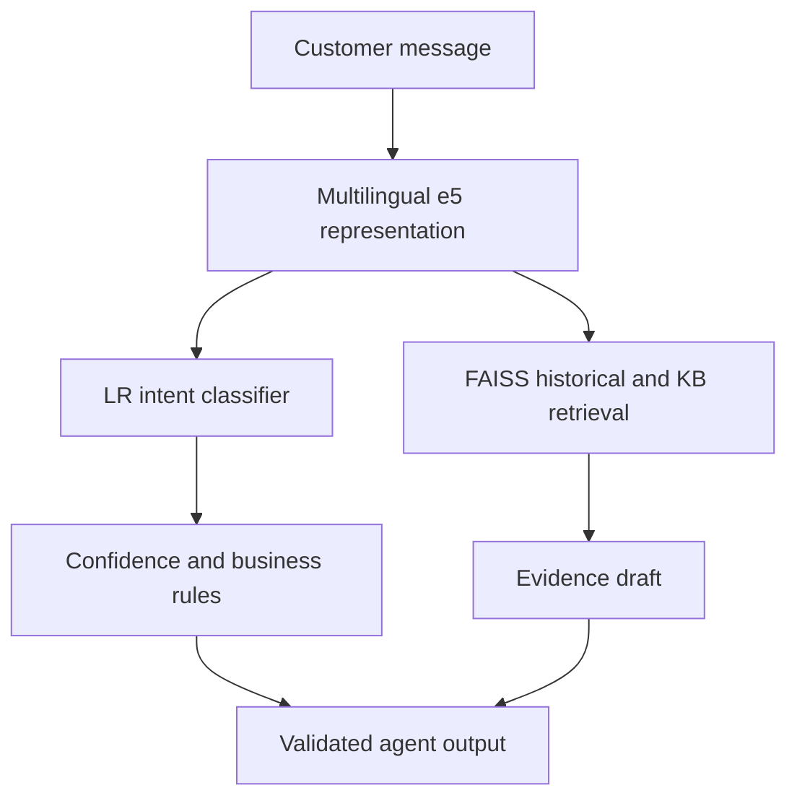

# Intelligent Support Ticket Assistant

**Team:** Mohammad · **Use case:** Intelligent Support Ticket Assistant

**[Open the live browser demo](https://mohammad-ticket-assistant.cool-dill-2655.chatgpt.site)** · Local Python interface: `python app.py`

Course: [SDAIA Academy — Applied NLP Engineering](https://sdaiaacademy.github.io/applied-nlp/). This README follows the [official capstone README template](https://github.com/SDAIAAcademy/applied-nlp/blob/main/labs/capstone/TEMPLATE_README.md).

## Problem

Support agents must interpret customer requests, find the correct policy and draft consistent replies across English and Arabic. This assistant provides a structured draft for an agent to review.

**Our system takes** an English or Arabic support message **and produces** an intent, category, rule-based priority, similar resolved cases, cited knowledge-base evidence and a draft reply, **measured by** macro-F1 on 513 held-out messages and retrieval Hit@3 on 24 answerable test queries.

DemoMart and its policies are fictional course data. Documentation, code comments, notebook explanations and interface labels are in English. Arabic appears in customer-language data, lexical rules and sample replies.

## Data

| Split | English | Arabic | Purpose |
|---|---:|---:|---|
| Train | 2700 | 108 | Fit classifier heads |
| Validation | 405 | 54 | Select C and thresholds |
| Held-out test | 405 | 108 | Compare classifiers |
| Historical cases | 1200 | 0 | Retrieve resolved examples |

There are 27 intents, 33 KB sections, and 10 authored out-of-domain validation inputs. English data comes from Bitext; Arabic classification test messages and the original KB come from the course. Arabic training and validation examples are authored for this project. Dataset attribution and model revisions are documented in [DATA_SOURCES.md](docs/DATA_SOURCES.md) and `configs/project.json`.

Canonical template groups are disjoint across splits. A semantic audit flags 312 test messages above cosine 0.95 to training (309 English and 3 Arabic). Filtered metrics are included. The prepared CSV snapshot and its hashes are bundled; the full raw Bitext download and Transformer weights are obtained by the preparation/model loaders.

Labels and definitions: [labels.csv](docs/labels.csv).

## Approach



The e5 encoder stays frozen. Logistic Regression learns the intent head. Category uses an intent-to-category map, and priority uses explicit business rules. Normalized vectors support cosine search with FAISS. Heading-based chunks preserve KB source IDs. The final retriever is dense search; BM25/RRF remains a measured alternative.

The default draft reproduces source text or a source-linked authored Arabic summary. Optional Qwen selects sentence numbers with a validated JSON schema, one correction retry and a source-preserving fallback. It cannot add free-form policy details through that selection interface, but it can select irrelevant evidence.

## Results (held-out test set)

All three classifiers use the same 513-message held-out test.

| System | Macro-F1 (all) | Macro-F1 (AR) | p95 latency | Cost / 1k | Notes |
|---|---:|---:|---:|---|---|
| Baseline: TF-IDF + LR | 0.8481 | 0.0026 | 2.57 ms | $0 external API fees | English training |
| Improvement: frozen e5 + LR | 0.8879 | 0.4748 | 16.23 ms | $0 external API fees | English training |
| Adapted: frozen e5 + bilingual LR | 0.9381 | 0.7249 | 16.31 ms | $0 external API fees | Bilingual training; encoder frozen |

Latency covers warm representation and classification, excluding loading, retrieval and drafting. Hardware and hosting costs are unpriced.

The final AR acceptance coverage is 0.2963, with accepted accuracy 1.0000 on only 32 messages. The warm classifier p95 is approximately 16.3 ms on the reference CPU. Final dense retrieval reaches test Hit@3 0.8333. External API fees are zero; hardware and hosting costs are unpriced.

This is a whole-system comparison: validation chooses C=5 for English-only e5 and C=50 for bilingual e5. It is not an isolated data ablation. The full [evaluation report](eval/EVALUATION_REPORT.md) provides language/dialect slices, bootstrap intervals, latency scope and known failures. The [error analysis](docs/ERROR_ANALYSIS.md) reviews 12 actual mistakes. Nine behavioral tests pass, and six unrelated smoke inputs produce five rejections and one false acceptance.

Bootstrap 95% confidence intervals (400 resamples) are saved with the [evaluation artifacts](eval/) and explained in the [evaluation report](eval/EVALUATION_REPORT.md). They are descriptive, with a fixed 27-label universe.

The project follows the capstone's permitted written-justification alternative to encoder or LoRA fine-tuning. The frozen encoder plus trained LR head improves Arabic performance with a small authored dataset. [ADAPTATION_JUSTIFICATION.md](docs/ADAPTATION_JUSTIFICATION.md) documents the measured evidence and the experiments still needed. Transformer weights are not fine-tuned.

## Error analysis

The final classifier has 32 raw-label errors; 12 actual mistakes were manually reviewed. Cause tags are reviewer interpretations.

| Cause | Count (of 12 reviewed) | Example / evidence | Next action |
|---|---:|---|---|
| Intent boundary | 6 | Accepted `get_invoice` → `check_invoice` mistake | Add contrasting invoice examples |
| Missing dialect coverage | 3 | See reviewed messages in error analysis | Collect diverse dialect data |
| Typo | 1 | See saved error record | Evaluate realistic spelling noise |
| Ambiguous wording | 1 | See saved error record | Request clarification |
| Transliteration | 1 | See saved error record | Add transliterated training examples |

See [ERROR_ANALYSIS.md](docs/ERROR_ANALYSIS.md) and [error_analysis.csv](eval/error_analysis.csv) for the actual inputs, labels and predictions. Nine behavioral tests passed in the reference environment. The scope smoke test rejects five of six unrelated queries; the Mars orbital-period question is incorrectly accepted.

## Reproduce

Python 3.12 is the reference version. Run commands from the repository root.

### Public browser demo

Open the [live demo](https://mohammad-ticket-assistant.cool-dill-2655.chatgpt.site), select an example or enter an English or Arabic message, and click **Load assistant**. First use downloads approximately 470 MB of full-precision model weights from Hugging Face, plus tokenizer/runtime files. Keep the tab open; a recent desktop browser is recommended. After loading, use **Analyze ticket**. No Python installation or API key is needed for visitors.

The dark interface displays the intent, model confidence, priority, category, reply draft, citations, related cases and downloadable JSON. Confidence describes one prediction; it is not the project's test accuracy. Messages are processed on the visitor's device.

The web demo uses the original pinned e5 model's FP32 ONNX export, the saved LR coefficients, unchanged language thresholds and the existing dense retrieval vectors. It follows the default `use_llm=False` path; optional Qwen and BM25/RRF experiments remain available in Python. The original Python pipeline, trained artifacts, splits and benchmark results are unchanged. [Web build and parity checks](docs/WEB_DEMO.md) explain how to reproduce the browser version.

### Windows PowerShell

```powershell
py -3.12 -m venv .venv
.\.venv\Scripts\python.exe -m pip install -r requirements-cpu.txt
.\.venv\Scripts\python.exe app.py
```

### Linux CPU

```bash
python3.12 -m venv .venv
source .venv/bin/activate
python -m pip install -r requirements-cpu.txt
python app.py
```

Open the localhost URL printed by Gradio. The repository includes prepared CSV files and trained classifiers. Transformer weights download from Hugging Face on first use. The default path needs multilingual e5; the optional LLM path also needs Qwen. No API key is required. The exact CPU wheel depends on platform; Colab retains its installed PyTorch version.

### Google Colab or Jupyter

Open [Support_Ticket_Assistant.ipynb](notebooks/Support_Ticket_Assistant.ipynb) and execute the cells in order. In Colab, the initialization cell accepts the project ZIP. If setup requests a session restart, select **Runtime → Restart session** and rerun from the first cell; the extracted project is reused. The import cell stays blocked until setup is complete. A GPU is optional for the base pipeline and accelerates the optional local model. The Colab setup uses the installed PyTorch version, which can differ from the CPU reference run.

### Input and output

```bash
python -m src.pipeline --text "How do I delete my account?"
python app.py --llm
```

```python
from src.pipeline import assist

output = assist("How do I delete my account?")
print(output["intent"])
print(output["reply"])
print(output["citations"])
```

The output includes `predicted_intent`, accepted `intent`, `confidence`, `category`, `priority`, `route`, `order_id`, three `similar_tickets`, retrieved `kb_sections`, `reply`, `citations`, `needs_human`, and latency fields. Low-confidence decisions return `intent=null` and `route=human_review`. Every reply is a draft; the program performs no account or order operations.

Real sample inputs and outputs are in [sample_outputs_no_llm.json](eval/sample_outputs_no_llm.json). The optional local-model experiment is in [sample_outputs.json](eval/sample_outputs.json).

### Rebuild and evaluate

```bash
python -m src.prepare_data
python -m src.train
python -m src.evaluate
python -m src.demo --no-llm
python -m src.demo
python -m pip install -r requirements-dev.txt
python -m pytest -q
```

Seed 42 and frozen model revisions are in `configs/project.json`. The source hash and split hashes are in `data/manifest.json`; bundled file hashes are in `data/SNAPSHOT_SHA256.json`. A future source download from `main` can differ from the reference source, so source hashes must match when reproducing its scores. Models and thresholds are selected on validation. Test-informed model changes require a new held-out test set.

### Repository contents

| Path | Content |
|---|---|
| `src/` | Data preparation, representations, training, retrieval, drafting, pipeline and evaluation |
| `app.py` | English-labeled Gradio interface |
| `ui/` | Dark Gradio theme; presentation only |
| `web/` | Browser interface, worker, build and parity checks |
| `configs/` | Model revisions and hyperparameters |
| `data/` | Prepared bilingual splits, KB and source-linked Arabic reply data |
| `artifacts/` | Trained classifiers and training metadata |
| `eval/` | Predictions, metrics, samples, behavioral results and error evidence |
| `tests/` | Behavioral and evidence-integrity checks |
| `notebooks/` | Reproducible execution notebook |
| `docs/` | Evaluation supporting documents, sources, labels and the presentation |

The [presentation](docs/Capstone_Presentation.pptx) includes English and Arabic input/output examples, benchmark results, behavioral tests and observed failures.

## Limitations and next steps

English templated data overstates generalization. Arabic training coverage is small, and conservative thresholds reject most Arabic test inputs. Closed-set confidence does not detect all unrelated questions: the Mars orbital-period query receives an irrelevant delivery-policy draft. Optional Qwen preserves source text but answered the requested detail in only one of three reviewed selections. Source provenance is not proof of relevance. Priority and PII masking use basic rules, and production traffic, backend integration and real customer performance remain unmeasured.

With two more weeks, collect independent customer-like bilingual data, expand dialect coverage, train a scope detector and evaluate contrasting intent pairs on a new held-out test.

[Applied NLP Engineering](https://sdaiaacademy.github.io/applied-nlp/) and the [official capstone starter kit](https://github.com/SDAIAAcademy/applied-nlp/tree/main/labs/capstone).
